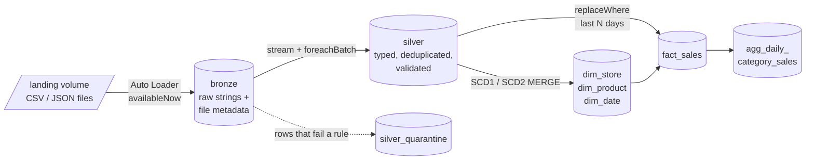
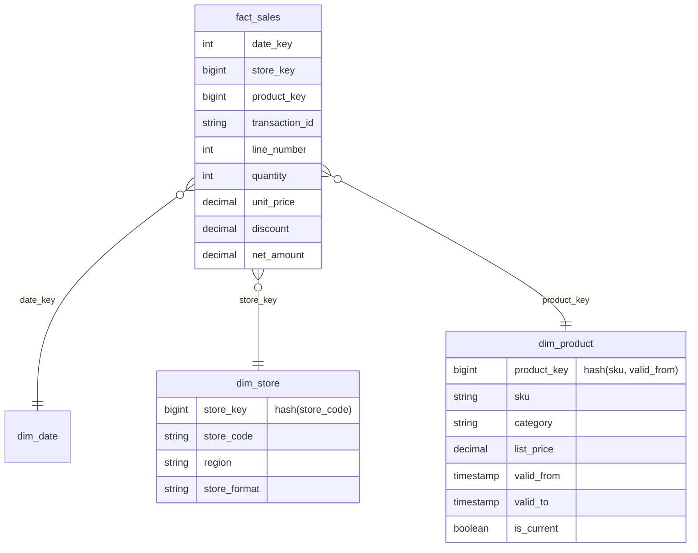

# Retail sell-out lakehouse on Databricks

[](https://github.com/dmerelo/retail-lakehouse-databricks/actions/workflows/ci.yml)

Daily point-of-sale files from a chain of 12 stores, plus product and store master data, turned into a star schema that a BI tool can query. Built on Databricks with Delta Lake, Unity Catalog volumes, Auto Loader and a serverless job defined as a Databricks Asset Bundle.

The data is synthetic, but it breaks the way real retail feeds break: codes with stray spaces, lines re-sent the next day, sales arriving late, prices and categories changing mid-week. Most of the code exists to deal with that.



## Data model



Grain of `fact_sales`: one line of a receipt. Each line points to the product **version** that was valid at the time of sale, so revenue by category stays correct after a product is moved to another category.

## Design decisions

**Bronze keeps everything as strings.** If a file arrives with `quantity = "abc"`, that value is still in the lake and can be shown to the source team. Casting happens in silver with `try_cast` / `try_to_timestamp`, because Databricks runs with ANSI mode on and a plain cast would fail the whole batch.

**Broken rows go to quarantine, not to /dev/null.** Every rule is a boolean column; a row that fails any rule lands in `silver_quarantine` with the list of rules it broke and the file it came from. A null result counts as a failure, so `quantity > 0` also catches a missing quantity.

**Incremental by default, safe to rerun.** Auto Loader and the bronze-to-silver stream keep checkpoints, so each file and each bronze row is processed once. Silver MERGEs only overwrite a record when the incoming one is newer, so replaying an old file cannot undo a newer value.

**SCD2 built from versions, applied with one MERGE.** `silver_products` keeps every version of a product. `scd.stage_scd2` chains the versions that are newer than the dimension's current row (several changes in one load are ordered by their effective time; identical consecutive versions collapse). `apply_scd2` closes the old row and inserts the new ones in the same Delta commit. The change detection is plain DataFrame code, so it is unit tested without Delta.

**Facts are rebuilt for a window, not appended.** Gold recomputes the last `lookback_days` (default 7) and writes them with `replaceWhere`. A sale that arrives two days late is picked up by the next run, and running the same window twice produces the same table.

**Stable surrogate keys.** `store_key = xxhash64(store_code)` and `product_key = xxhash64(sku, valid_from)`: no sequence table to maintain, and a rebuilt dimension keeps the same keys. Lookups that find nothing get the unknown member (`-1`); the run fails if more than 1% of fact lines end up there.

**Serverless-friendly.** No `.cache()` (not supported on serverless), no cluster configuration in the job, notebooks import the package from `src/`.

## Data quality rules

| Entity | Rule | Example caught in the sample data |
|---|---|---|
| sales | `sku_present`, `transaction_id_present`, `line_number_valid` | empty SKU |
| sales | `sale_ts_parsed`, `sale_not_in_future` | `2026/13/45 25:00` |
| sales | `quantity_positive`, `unit_price_non_negative`, `discount_not_above_gross` | price `-3.90`, quantity `0` |
| sales | `store_known` (checked against the store master) | store `LJ999` |
| sales | `channel_known` | channel `telefone` |
| products | `sku_present`, `category_present`, `list_price_non_negative`, `updated_at_parsed` | |
| stores | `store_code_present`, `state_is_uf`, `updated_at_parsed` | |

Fixable problems are fixed instead of rejected: `"  sku-1003 "` becomes `SKU-1003`, repeated spaces are collapsed, missing discount becomes 0.

## Running it

**On Databricks (Free Edition works):**

1. *Workspace → Create → Git folder* and paste this repository URL.
2. Open `notebooks/00_setup.py` and run it. It creates the `retail` schema, the `landing` and `checkpoints` volumes and 14 days of sample files.
3. Either run `01_bronze`, `02_silver` and `03_gold` in order, or deploy the job: open `databricks.yml`, click *Deploy* in the bundle panel and run `retail-sales-daily`.
4. `04_analysis.sql` has example queries (revenue by region and week, price before/after a list price change, rejected rows per rule).

To simulate new days arriving, run `00_setup` again with a later `end_date` and rerun the job: only the new files are processed.

**Tests locally:**

```bash
pip install -r requirements-dev.txt
pytest -q                     # transformation logic, plain Spark
RUN_DELTA_TESTS=1 pytest -q   # also the end-to-end run on Delta (downloads the Delta jars)
```

CI runs both on every push.

## Layout

```
databricks.yml                 bundle definition (catalog / schema variables)
resources/retail_sales.job.yml serverless job: bronze -> silver -> gold, retries, schedule (paused)
notebooks/                     thin entry points: widgets, streams, display
src/lakehouse/
  bronze.py                    Auto Loader / batch readers, ingestion metadata
  silver.py                    cleaning, validation, dedup, MERGE
  quality.py                   rule engine and run-level checks
  scd.py                       SCD2 staging + MERGE
  gold.py                      dimensions, fact, aggregate
  pipeline.py                  gold orchestration (shared by notebook and tests)
  sample_data.py               synthetic feed with injected problems
tests/                         unit tests + end-to-end test on Delta
```

## What I would change for a real deployment

- Read silver changes with Change Data Feed instead of re-reading `silver_products` to stage SCD2; fine at catalog size, not for a large dimension.
- Move the rules to Lakeflow Declarative Pipelines expectations if the team standardizes on it; the rule list maps one to one.
- Liquid clustering on `fact_sales` by `(sale_date, store_key)` instead of date partitions once volume grows.
- Alerts on the quarantine table (rows per rule per day) rather than only failing on the unknown-product ratio.
